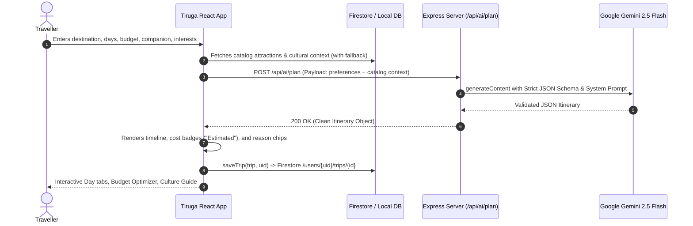

# Tiruga (ತಿರು ಗ) — Architecture & Data Flow

## 1. System Overview

Tiruga is an AI-powered Karnataka travel companion built with a client-first React SPA and a security-hardened Express backend proxying Google Gemini 2.5 Flash and Firebase services.

```mermaid
graph TD
    User([User Device / Browser]) -->|PWA / Offline First| SPA[React SPA (Vite + Tailwind)]
    
    subgraph Client State & Storage
        SPA -->|Auth State| AuthCtx[AuthContext (Google Sign-In / Guest)]
        SPA -->|IndexedDB / Memory| LocalCache[Firestore Local Cache & Storage]
        SPA -->|Static Fallback| JSONData[Local Curated JSON Catalog]
    end

    subgraph Backend Server (Express on Node.js)
        SPA -->|POST /api/ai/*| AIServer[Server AI Gateway]
        SPA -->|GET /api/health| HealthCheck[Health Check Route]
        AIServer -->|Protected by Timing-Safe Secret| SeedRoute[Admin Seed Route]
        AIServer -->|Structured Prompts| GeminiSDK[@google/genai SDK (Gemini 2.5 Flash)]
    end

    subgraph Cloud Infrastructure
        AIServer -->|Server-Side Only Key| GeminiAPI[Google Gemini 2.5 Flash API]
        LocalCache <-->|Read / Write with firestore.rules| Firestore[(Cloud Firestore)]
        AuthCtx <-->|OAuth 2.0 Popup| FirebaseAuth[Firebase Auth]
    end
```

---

## 2. End-to-End AI Itinerary Flow



---

## 3. Component Hierarchy

```text
src/
├── App.tsx                     # Top-Level Root, ErrorBoundary, Suspense & Routes
├── components/
│   └── common/
│       ├── CommonComponents.tsx  # Button, Card, Chip, Skeleton, EmptyState, BottomNav
│       ├── DemoToolsPanel.tsx    # Stage Demo Shortcuts (?demo=1 only)
│       └── AskAboutPlaceSheet.tsx# Reusable Place Culture Modal
├── features/
│   ├── home/HomeScreen.tsx     # Destination search, category chips, continue trip
│   ├── plan/
│   │   ├── PlanScreen.tsx      # Step wizard (destination, days, budget, interests)
│   │   └── TripPlanScreen.tsx  # Timeline, day tabs, Budget Optimizer, AI modify
│   ├── kannada/KannadaScreen.tsx # Pronunciation, situational generator, audio TTS
│   ├── planb/PlanBScreen.tsx   # Weather contingency (Rain, Heat, Crowd)
│   ├── travel/TravelOptionsScreen.tsx # Buses, trains, cabs (Demo data)
│   ├── nearby/NearbyScreen.tsx # Illustrative SVG map with attraction pins
│   ├── offline/OfflineScreen.tsx # Saved itineraries & cached maps
│   └── profile/ProfileScreen.tsx # Auth profile, travel preferences & saved trips
└── lib/
    ├── auth.tsx                # Google Auth popup & guest session manager
    ├── db.ts                   # Firestore data access with offline JSON fallback
    ├── firebase.ts             # Firebase client SDK initialization & multi-tab cache
    └── preferences.ts          # Top-level user preferences persistence
```

---

## 4. Security & Zero-Secret Architecture

1. **Client Isolation**: The client SPA never possesses `GEMINI_API_KEY` or Firebase Admin service accounts.
2. **Reverse Proxying**: All AI requests are handled by `/api/ai/*` routes on the Express server.
3. **Database Security**: Enforced via declarative `firestore.rules`:
   - Catalog collections (`destinations`, `attractions`, `phrases`, `transport`) are **read-only** (`allow write: if false`).
   - User data (`users/{uid}`, `trips`, `savedPlaces`) is strictly isolated using `request.auth.uid == uid`.
   - Field validations enforce permitted attributes and types.
4. **Seed Endpoint**: Protected by `SEED_ENABLED === "true"` and `crypto.timingSafeEqual` comparison on `SEED_SECRET`.
